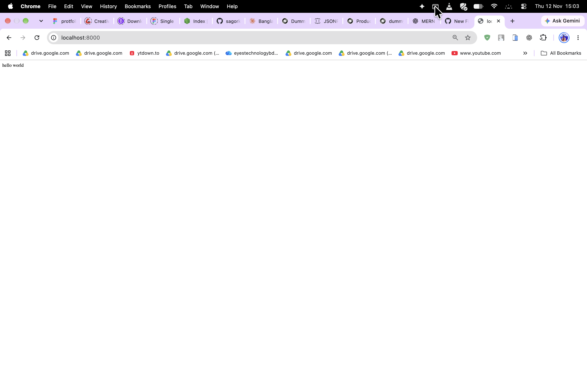
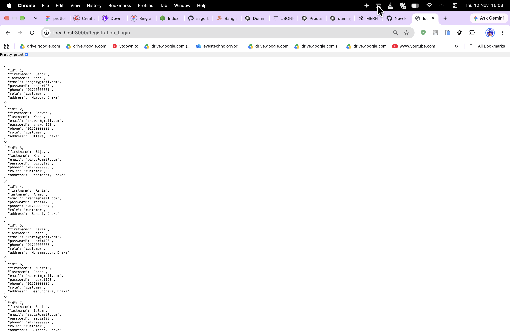
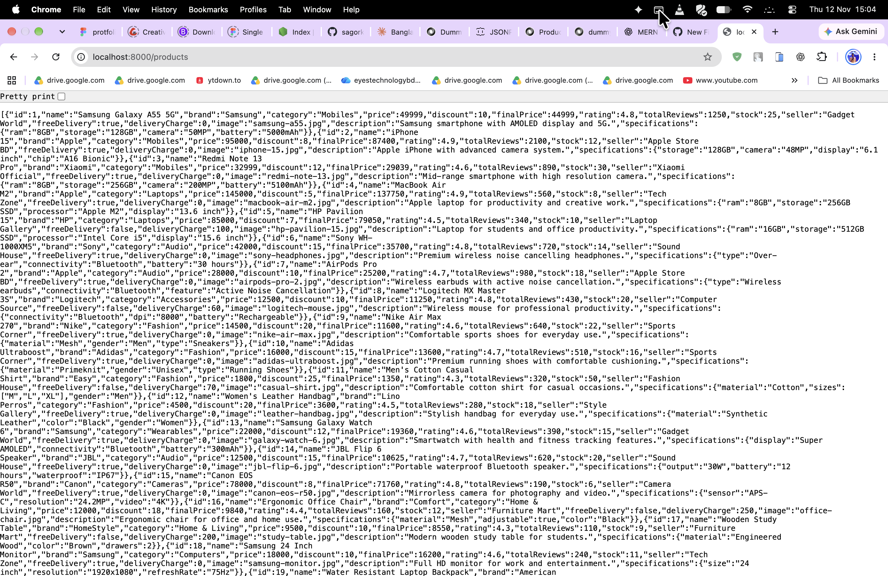

# Node.js - Class 7 Homework

## About
This repository contains my Class 7 practice work from my Node.js and Backend Development course at Creative IT.

The purpose of this homework is to practise setting up an Express.js server and creating basic GET API routes.

## Topics Covered
- Node.js and Express.js
- Express server setup
- GET requests
- Express routing
- Registration and Login sample data
- Product sample data

## Implemented API Routes

| HTTP Method | Endpoint | Description |
|---|---|---|
| GET | `/` | Display welcome message |
| GET | `/Registration_Login` | Display registration and login data |
| GET | `/products` | Display product data |

## Technologies Used
- JavaScript
- Node.js
- Express.js

## How to Run

1. Clone or download this repository.
2. Open the project folder in VS Code.
3. Install dependencies:

   ```bash
   npm install
   ```

4. Start the server:

   ```bash
   node index.js
   ```

5. Open the following URL in your browser:

   `http://localhost:8000`

## API Output Screenshots

### 1. Home Route


### 2. Registration and Login Data


### 3. Product Data


## Learning Outcomes
Through this homework, I practised:
- Creating an Express.js server.
- Defining GET routes.
- Understanding basic API endpoints.
- Sending JSON data as an API response.
- Organising sample user and product data.

## Note
This is a beginner-level learning project. Data is stored in JavaScript arrays for practice and is not permanently saved in a database.